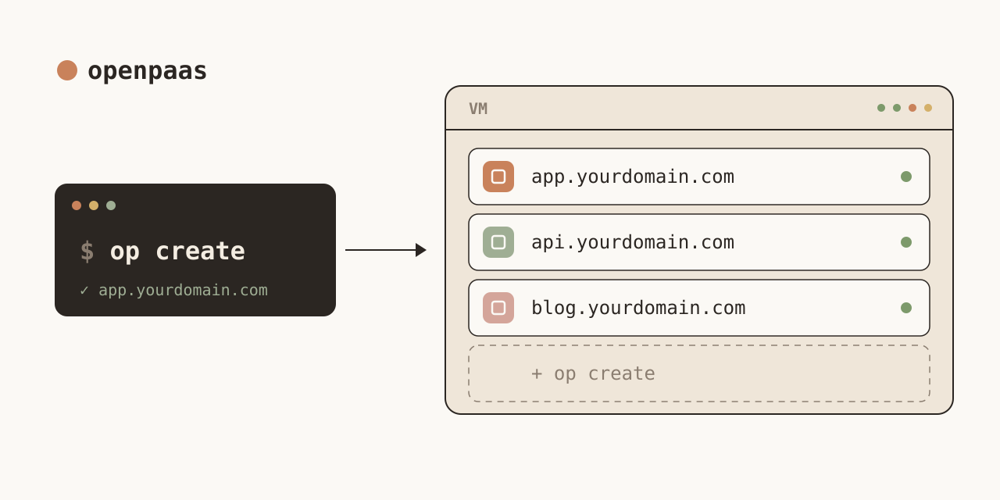

<div align="center">

# OpenPaaS

**Turn that spare cloud VM into your own personal Heroku.**

One domain, one command per app, and every project gets its own HTTPS subdomain.

[](https://github.com/diezo/OpenPaaS/releases)
[](https://github.com/diezo/OpenPaaS/actions/workflows/ci.yml)
[](LICENSE)

</div>

<p align="center">
  
</p>

You have a VM sitting idle and a handful of side projects with nowhere to live. OpenPaaS takes care of the nginx configs, certificates, port bookkeeping and "why is this container down?" so you can get back to building.

## What you get

- **A subdomain per app.** `op create blog` serves your app at `blog.yourdomain.com`.
- **HTTPS automatically.** Every subdomain gets a Let's Encrypt certificate, and certbot renews it.
- **Any Docker image.** Public images and **private GitHub Container Registry** images both work.
- **Self-healing.** Containers restart if they crash and come back after a reboot.
- **No port juggling.** OpenPaaS picks a free port for every app and keeps apps off the public internet; only nginx can reach them.
- **Lightweight.** It's a single ~8 MB Go binary with no database and no web dashboard eating your RAM.

## Quickstart

You'll need a **Debian or Ubuntu VM** with a public IP, **a domain you own**, and about five minutes.

**1. Install** on your VM:
```sh
curl -fsSL https://raw.githubusercontent.com/diezo/OpenPaaS/main/install.sh | sudo bash
```
This installs nginx, certbot and Docker (skipping any already installed), then the `op` command.

**2. Set up.** OpenPaaS walks you through it:
```sh
sudo op setup
```
It asks for:
1. a [GitHub token](https://github.com/settings/tokens/new?scopes=read:packages&description=OpenPaaS) (a classic token with `read:packages`, for pulling your private images);
2. your domain;
3. an email for certificate expiry notices (optional).

It then tells you exactly which DNS records to add and checks them for you.

**3. Deploy something:**
```sh
sudo op create hello --image nginxdemos/hello:latest --port 80
```
Open `https://hello.yourdomain.com`. That's it: you have a PaaS. 🎉

## Before you start: two things that trip everyone up

### 1. Open ports 80 and 443 in your cloud firewall
Your cloud provider has its own firewall in front of your VM, separate from the VM itself. If 80/443 are closed there, certificates can't be issued and nobody can reach your apps.

| Provider | Where to open them |
|---|---|
| **AWS EC2** | Security group → Inbound rules → add HTTP (80) and HTTPS (443) from `0.0.0.0/0` |
| **Google Cloud** | VPC network → Firewall → allow `tcp:80,443`, or tick "Allow HTTP/HTTPS traffic" on the VM |
| **Azure** | VM → Networking → add inbound port rules for 80 and 443 |
| **Oracle Cloud** | VCN security list → ingress rules for 80 and 443. Oracle's Ubuntu images **also** block these ports inside the VM with iptables, so open them there too |
| **DigitalOcean / Hetzner / Linode** | Usually open by default. If you added a cloud firewall, allow 80 and 443 |

If `ufw` is active on the VM itself, `op setup` opens 80/443 there for you.

### 2. Point your domain at the VM
`op setup` shows you these, but here they are up front:

| Type | Name | Value |
|---|---|---|
| A | `yourdomain.com` | your VM's public IP |
| A | `*.yourdomain.com` | your VM's public IP |

The `*` record is what makes every new app's subdomain work instantly, with no DNS change per app.

Two notes:
- **On Cloudflare,** set both records to **DNS only** (grey cloud).
- **Remove any old records for specific subdomains.** A record such as `blog.yourdomain.com` pointing at an old server takes priority over the `*` wildcard.

## Deploying apps

```sh
sudo op create <slug>
```
OpenPaaS asks for two things:
- **The image,** for example `ghcr.io/you/app:latest`. Use the `:latest` tag: auto-redeploy is coming, and it re-pulls the tag you deploy with.
- **The port your app listens on inside the container.** If the image declares one, it's pre-filled; just press Enter.

Then it:
1. pulls the image;
2. starts the container;
3. routes `<slug>.yourdomain.com` to it;
4. gets a certificate.

If anything fails before the certificate step, it rolls everything back, so a failed deploy leaves no mess behind.

To skip the questions (handy in scripts):
```sh
sudo op create api --image ghcr.io/you/api:latest --port 8080
```

### See what's running
```console
$ sudo op ls
SLUG   URL                        IMAGE                     PORTS        STATUS
api    https://api.example.com    ghcr.io/you/api:latest    10001→8080   ● running · up 3h
blog   https://blog.example.com   ghcr.io/you/blog:latest   10000→3000   ● running · up 2d

2 services · 2 running
```
`op ls` also flags apps that crashed (`● exited (1) · 5m ago`) and apps that keep restarting (`● crash-looping`).

### Remove an app
```sh
sudo op delete blog
```
This removes the container, the subdomain route and the certificate.

## Commands

| Command | What it does |
|---|---|
| `sudo op setup` | Set up OpenPaaS, or change your token, domain or email (press Enter to keep a value) |
| `sudo op create <slug>` | Deploy a Docker image at `https://<slug>.yourdomain.com` |
| `sudo op ls` / `op list` | List apps with their URLs, ports and live status |
| `sudo op delete <slug>` | Remove an app |
| `sudo op status` | Check your domain, the deploy API and certificate expiry |
| `op version` | Print the installed version |

## Upgrading

Run the installer again. It upgrades `op` and leaves your apps and settings alone:
```sh
curl -fsSL https://raw.githubusercontent.com/diezo/OpenPaaS/main/install.sh | sudo bash
```

## Troubleshooting

<details>
<summary><b>The TLS certificate step fails</b></summary>

Almost always one of these:
- **Ports 80/443 are blocked** in your cloud firewall. See [above](#1-open-ports-80-and-443-in-your-cloud-firewall).
- **DNS hasn't propagated yet.** Wait a few minutes and run the command again.
- **You hit Let's Encrypt's rate limit:** 5 certificates per week for the exact same name. This happens if you create and delete the same slug many times. Wait it out, or use a different slug.

The app still works over `http://` in the meantime. The full log is in `/var/log/openpaas/services.log`.
</details>

<details>
<summary><b>The browser says "Not secure" even though the certificate was issued</b></summary>

Check `sudo op ls`. If the URL says `https://`, your VM is fine, and the problem is usually a cached DNS record or certificate on your side. Try an incognito window, or flush DNS (`ipconfig /flushdns` on Windows). Also check for an old DNS record for that subdomain that overrides the wildcard.
</details>

<details>
<summary><b>An app shows "exited" or "crash-looping"</b></summary>

Your app is crashing on start. Check its logs:
```sh
sudo docker logs op-<slug>
```
A common cause is the wrong internal port, or an app that only listens on `localhost`. Inside a container it needs to listen on `0.0.0.0`.
</details>

<details>
<summary><b>A private ghcr.io image won't pull</b></summary>

- The GitHub account that owns your token must have access to the package.
- If the package belongs to an organization that uses SSO, approve your token for that org on GitHub's token page ("Configure SSO").
- To update the token, run `sudo op setup`.
</details>

## How it works

```
                 ┌──────────────────────── your VM ────────────────────────┐
  blog.you.com ──┼─▶ nginx :443 ──▶ 127.0.0.1:10000 ──▶ container op-blog  │
  api.you.com  ──┼─▶ (TLS)      ──▶ 127.0.0.1:10001 ──▶ container op-api   │
  deploy.you.com ┼─▶            ──▶ 127.0.0.1:7777  ──▶ OpenPaaS API       │
                 └─────────────────────────────────────────────────────────┘
```
- **nginx** serves everything on ports 80/443 and handles TLS.
- **Each app** runs in its own Docker container, published only on localhost, so it can't be reached around nginx.
- **The deploy API** at `deploy.yourdomain.com` is a small always-on service. It powers upcoming features like auto-redeploy.

Files OpenPaaS manages:

| Path | What's in it |
|---|---|
| `/etc/openpaas/config.json` | Your settings and token (readable by root only) |
| `/etc/openpaas/services.json` | Your apps and their reserved ports |
| `/etc/nginx/sites-available/openpaas-*.conf` | Generated nginx sites |
| `/var/log/openpaas/` | Install, setup and deploy logs |

## Roadmap

- **Auto-redeploy:** push a new `:latest` image from GitHub Actions, and OpenPaaS pulls it and swaps the container. See [docs/ROADMAP.md](docs/ROADMAP.md).
- Wildcard TLS
- `op uninstall`

Got an idea? [Open an issue](https://github.com/diezo/OpenPaaS/issues).

## Contributing

PRs welcome! To hack on it:
```sh
go test ./...
GOOS=linux GOARCH=amd64 go build -o op ./cmd/op
```
To try your build on a test VM, use the installer with a local binary:
```sh
sudo OP_BINARY=./op bash install.sh
```
Releases are automated: pushing a `vX.Y.Z` tag builds and publishes them.

## License

[MIT](LICENSE). Do whatever you like, just don't blame us if your side project goes viral. 🚀
